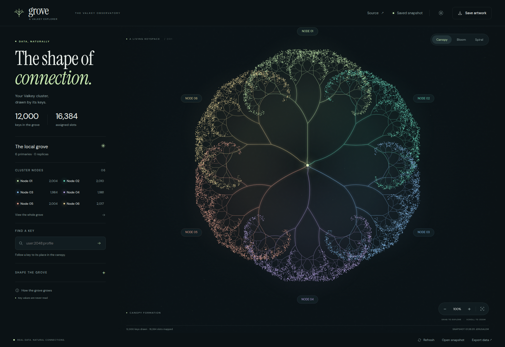
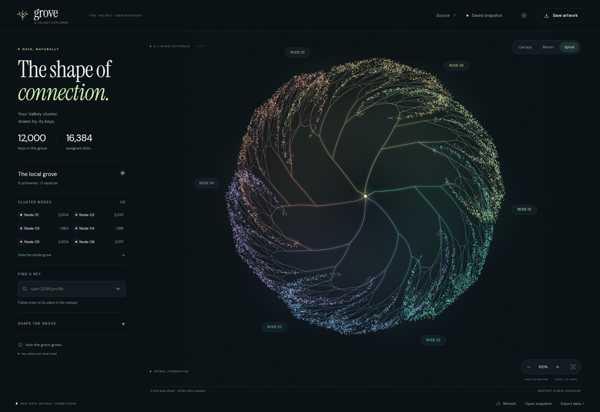
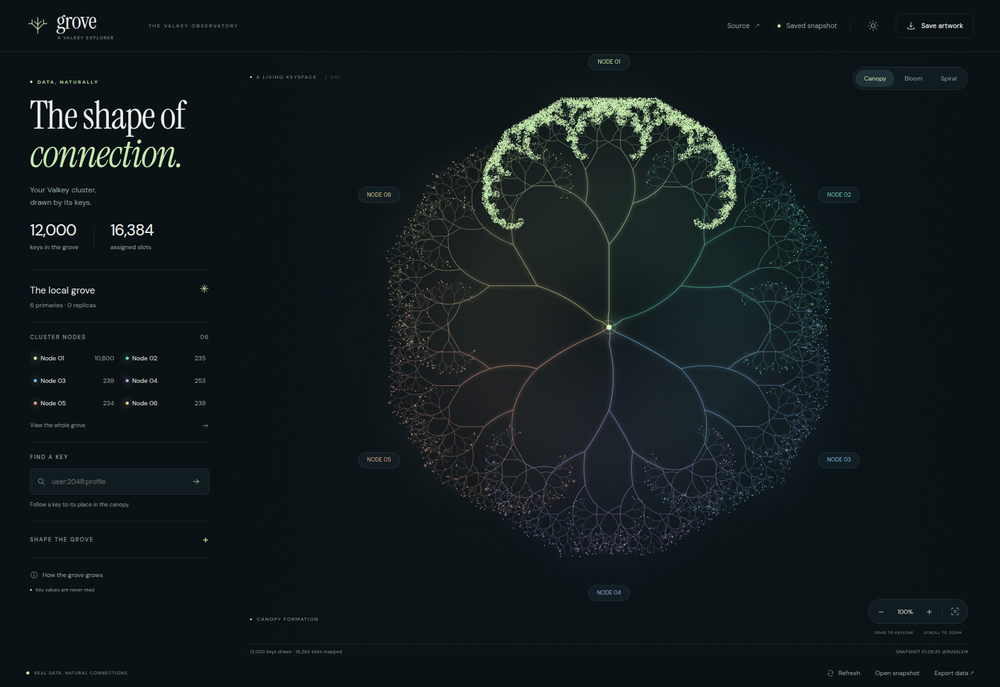
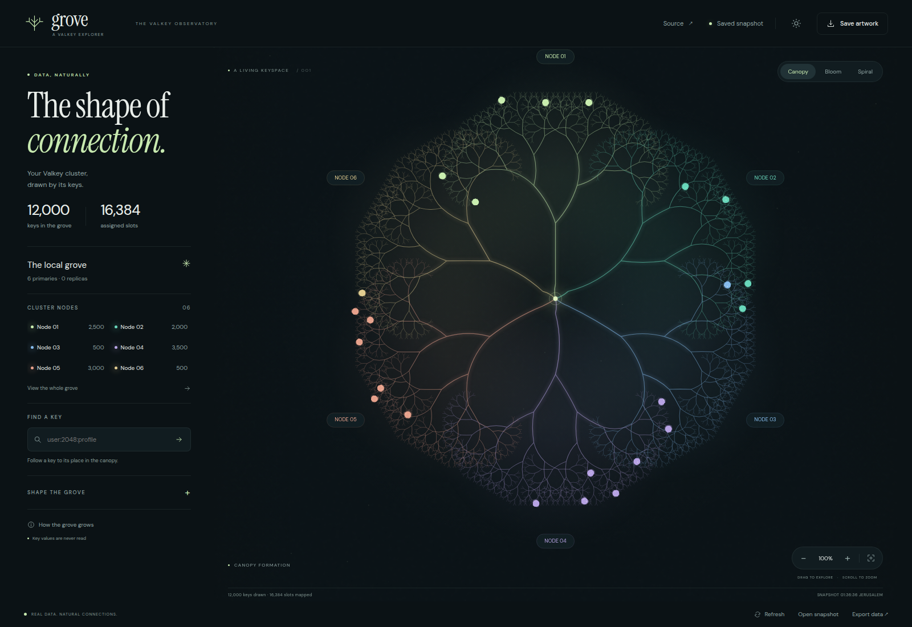

# Valkey Grove

See where your Valkey keys live. Each primary grows a fractal tree. Hash slots shape its branches. Keys form the leaves.



Go serves the app and reads the cluster. Canvas draws the keyspace. No npm dependencies or frontend build step.

## Formations

Canopy follows the branches outward. Bloom folds them into petals. Spiral winds them around the center. Key search and node selection work in every view.



## Three key distributions

These screenshots use 12,000 real keys in a temporary six-primary Valkey cluster. All keys were captured. The geometry settings stay the same: Canopy formation, 30° spread, depth 9, 100% zoom.

| Distribution | Keys per node | Occupied slots |
| --- | --- | --- |
| Uniform | 2,004 / 2,010 / 1,984 / 1,981 / 2,004 / 2,017 | 7,992 |
| Hot node | 10,800 / 235 / 239 / 253 / 234 / 239 | 3,718 |
| Hash tags | 2,500 / 2,000 / 500 / 3,500 / 3,000 / 500 | 24 |

### Uniform

Sequential key names spread across the cluster. Every tree carries about 2,000 keys.

### Hot node

90% of keys belong to node 01. The other five nodes share the remaining 10%. These are distinct keys spread over many slots, not one shared hash tag.



### Hash tags

24 tenant tags group 500 keys each into one slot. The leaves form small, dense clusters. The branches still show the full slot space.



The header counts **assigned** hash slots. The table counts **occupied** slots. These are different: the cluster owns all 16,384 slots in every screenshot, but some contain no keys.

[Capture receipts](docs/gallery-receipts.json) record the counts, timestamps and snapshot hashes. These are key-location patterns; Grove does not measure request traffic or throughput.

## Run the local grove

Requires Go 1.23+, Python 3, `valkey-server` and `valkey-cli` on Linux.

```sh
git clone https://github.com/avifenesh/valkey-grove.git
cd valkey-grove
python3 scripts/local-cluster.py up
```

Open **http://127.0.0.1:4187**. This starts six dedicated Valkey primaries on ports 7400–7405, assigns all 16,384 slots, and seeds 12,000 sample keys. It leaves an existing service on port 6379 alone. The sample cluster has no replicas or persistence and is for local exploration.

```sh
python3 scripts/local-cluster.py stop
```

Configuration and logs stay under `.local/`. `up` restores the sample dataset after a stop. `start`, `seed` and `serve` can also run separately.

## Use another cluster

```sh
go run . -cluster host:6379
# For TLS:
go run . -cluster host:6379 -tls
```

Set `VALKEY_USERNAME` and `VALKEY_PASSWORD` in your environment when authentication is required. Credentials are never sent to the browser. Node addresses returned by `CLUSTER SLOTS` must be reachable from the collector. TLS validates certificates using the system trust store.

The collector reads `CLUSTER SLOTS`, `DBSIZE` and `SCAN` from database 0. It does not read values or write to a cluster. The frontend refreshes every eight seconds while visible. A five-second cache combines repeated requests. `-sample 24000` bounds scan work and browser memory; the budget is shared equally across primaries. `DBSIZE` supplies the full key count. Scanning is not atomic and is not a statistically uniform sample. An unavailable node is marked offline, and partial data is labeled as such. The whole collection has a 15-second deadline. Binary names are preserved as base64 with their slot computed from the original bytes.

The local HTTP server binds to loopback, rejects foreign Host and Origin headers, and does not enable CORS. A remote hosted browser cannot directly connect to this local collector.

## Explore

- Select a primary to isolate its branches.
- Search a key name to trace its slot and node. A missing sampled key is shown as a calculated location, not proof that the key exists.
- Click a dot to inspect the observed key. Binary names are labeled as base64.
- Choose Canopy, Bloom or Spiral. Every formation uses the same key and slot data.
- Change branch spread or recursion depth; drag and zoom the canvas.
- Switch light/dark themes or pause motion. Reduced motion is respected.
- Save the artwork as PNG or export a JSON snapshot. Snapshots contain key names and node addresses; they stay local until you choose to share them.

The hosted edition opens a saved capture of this development cluster and supports local snapshot imports. It is labeled **Saved snapshot**. Use the local app for live data. Imported data is processed in the browser and is not uploaded.

## Reproduce the gallery

```sh
python3 scripts/gallery.py
```

This creates six temporary nodes on ports 7600–7605 and a temporary collector on 4188. It writes snapshots and a receipt to `.local/gallery/`, then stops its processes and removes its temporary cluster. It does not change your running Grove cluster.

Open Grove, choose **Open snapshot**, and load `uniform.json`, `hot-node.json` or `hash-tags.json`. The screenshots use the dark theme at 1600 × 1100. Use `--base-port`, `--http-port` and `--output` to change the ports or output directory.

## Validate

```sh
GROVE_TEST_PORT=7400 go test -race ./...
GROVE_TEST_PORT=7400 node --test test/*.test.mjs
go vet ./...
```

CI runs the CPU checks. Set `GROVE_TEST_PORT` locally to also run the real-cluster tests.

The tests compare text, Unicode, empty keys, and hash tags with a real Valkey cluster. A collector integration test writes and removes one temporary binary key in the dedicated test cluster and verifies its identity and slot survive JSON transport. HTTP tests cover the local access boundary and connection failure.

No frontend build step or runtime npm dependencies. `go build -o grove .` embeds `dist/` in the Go binary. Rebuild and restart after frontend edits. The visualization uses deterministic recursive geometry; CRC16/XMODEM and hash-tag rules follow the [Valkey cluster specification](https://valkey.io/topics/cluster-spec/).
